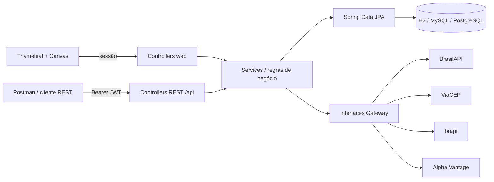
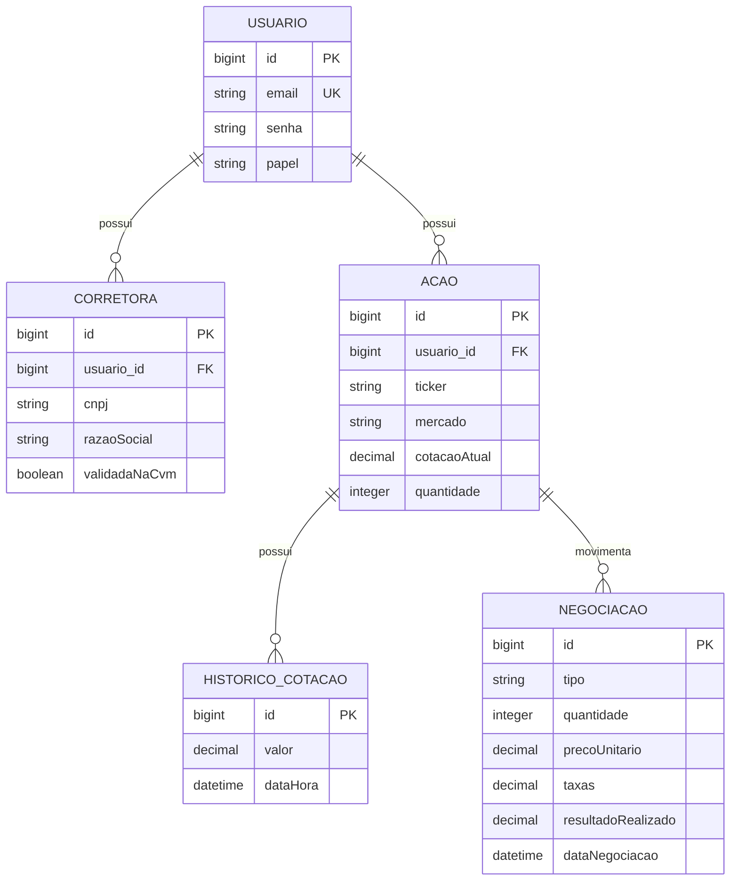

# Carteira de Ações

Aplicação acadêmica full stack em Java 17 e Spring Boot para gerenciar corretoras, ações brasileiras/americanas e negociações de compra e venda. O projeto inclui login validado, dashboard com gráficos, tabelas responsivas, API REST e especificações OpenSpec.

O visual usa como referência os padrões de navegação e densidade de informação do Status Invest e do Investidor10, sem copiar identidade visual, código ou conteúdo desses produtos.

## Funcionalidades

- Cadastro e login com Spring Security, BCrypt, validação de e-mail e política de senha.
- API REST em `/api/**` protegida por JWT (HS256) stateless, com login em `POST /api/auth/login`; o portal web continua usando sessão e CSRF.
- Controle de acesso por papéis (`USER` e `ADMIN`) com `@EnableMethodSecurity` e `@PreAuthorize`; somente `ADMIN` gerencia usuários.
- Cobertura de testes medida pelo JaCoCo, com portão que reprova o build abaixo do mínimo versionado.
- Carteiras totalmente isoladas por conta: uma conta nova começa sem ações, corretoras ou negociações e nunca consulta os dados de outro usuário.
- Cadastro de corretora somente após validação do CNPJ, registro na CVM e CEP.
- Cadastro de ações brasileiras e americanas somente quando o ticker existe no provedor correspondente.
- Proteção contra CNPJ, e-mail e ticker duplicados.
- Posição por ativo com saldo em unidades inteiras, preço médio, capital investido, patrimônio, resultado e rentabilidade.
- Registro de compras e vendas com preço de execução informado pelo usuário, taxa automática zero, prévia de valores, total desembolsado/recebido e resultado realizado.
- Atualização automática da posição: compras recalculam o preço médio; vendas preservam o preço médio restante e só alteram saldo e resultado realizado.
- Atualização da cotação pelo provedor com histórico persistido.
- Dashboard financeiro com doze gráficos, incluindo quatro visões simples de preço médio: valor por ação, comparação com a cotação, distância percentual e evolução por ativo. Todos os ativos brasileiros e americanos aparecem sem limite na central de preço médio.
- Logos das empresas identificadas pelo ticker na central de preço médio, nas posições, na gestão de ativos e no histórico, com inicial automática quando a imagem não estiver disponível.
- Navegação superior com dez abas e atalhos diretos para resumo, preço médio, resultados, posições, ativos, negociações, histórico, corretoras, Imposto de Renda e configurações.
- Histórico completo com busca e filtros por operação e mercado, além de volume e resultado realizado separados por moeda.
- Tela de apoio ao Imposto de Renda com consolidação anual de vendas e resultados em BRL e USD, acompanhada de avisos sobre as limitações do cálculo.
- Configurações locais de tema, movimento e densidade, persistidas no navegador.
- Temas persistentes preto piano com dourado e branco com dourado, alternância instantânea e fundo original de mármore animado com suporte a movimento reduzido.
- Identidade visual própria com símbolo geométrico de evolução financeira no lugar da antiga inicial `C`.
- Resumos separados em BRL e USD para não somar moedas diferentes de forma incorreta.
- API REST com paginação e erros centralizados no formato `ProblemDetail`.
- Documentação técnica OpenAPI restrita a administradores e removida da navegação do usuário comum.
- Configuração externa por variáveis de ambiente, sem senhas versionadas.
- Schema versionado pelo Liquibase e validado pelo Hibernate.
- Perfis de banco para H2, MySQL e PostgreSQL.
- Imagem Docker multi-stage e ambiente Compose com aplicação e PostgreSQL.
- Especificações de comportamento no diretório `openspec/`.

## Executar localmente com H2

Pré-requisitos: Java 17+ e Maven 3.9+.

A API exige a variável `JWT_SECRET` com pelo menos 32 bytes aleatórios. Sem ela, a aplicação não inicia e informa o motivo. Gere uma chave e coloque-a no `.env` (ou na configuração de execução da IDE):

```powershell
$bytes = New-Object byte[] 32; [Security.Cryptography.RandomNumberGenerator]::Create().GetBytes($bytes); [Convert]::ToBase64String($bytes)
```

```powershell
mvn spring-boot:run
```

Acesse [http://localhost:8080](http://localhost:8080). O banco H2 é criado em `./data` e o Liquibase controla sua estrutura.

Na primeira execução, crie a conta pela opção **Criar conta** na tela de login. Um usuário inicial pode ser habilitado somente por variáveis de ambiente:

```powershell
$env:DEMO_USER_ENABLED="true"
$env:DEMO_USER_EMAIL="admin@carteira.com"
$env:DEMO_USER_PASSWORD="defina-uma-senha-forte"
mvn spring-boot:run
```

Não existe senha-padrão no código. Se `DEMO_USER_ENABLED=true`, `DEMO_USER_PASSWORD` passa a ser obrigatória.

## Chaves das APIs financeiras

A brapi permite testar alguns tickers (como `PETR4`, `VALE3`, `MGLU3` e `ITUB4`) sem token. Para cobertura completa, configure:

```powershell
$env:BRAPI_TOKEN="seu-token-brapi"
$env:ALPHA_VANTAGE_API_KEY="sua-chave-alpha-vantage"
mvn spring-boot:run
```

Sem chave própria da Alpha Vantage, a chave pública `demo` normalmente permite apenas o ticker `IBM`.

## Integrações externas

| Integração | Uso | Autenticação | Limitações principais |
|---|---|---|---|
| [BrasilAPI CNPJ](https://brasilapi.com.br/docs) | Dados cadastrais da Receita Federal | Não | Serviço comunitário; sujeito a indisponibilidade e atualização da fonte |
| [BrasilAPI CVM](https://brasilapi.com.br/docs) | Confirmação de corretora registrada | Não | Reflete a base pública disponibilizada pela CVM |
| [ViaCEP](https://viacep.com.br/) | Validação e preenchimento de endereço | Não | CEP válido pode não existir; uso massivo pode ser bloqueado |
| [brapi](https://brapi.dev/docs) | Cotações e histórico de ativos brasileiros | Token para cobertura completa | Plano gratuito e tickers de teste possuem limites |
| [Alpha Vantage](https://www.alphavantage.co/documentation/) | Cotação de ações americanas | API key | Limite de requisições; cotação gratuita pode ser de fechamento |

Os clientes possuem timeout de conexão/leitura. Erros de ticker, CNPJ ou CEP inexistente, indisponibilidade e limites externos são convertidos em mensagens de domínio e, na API, retornados como HTTP `422` ou `502`.

## Segurança da API com JWT

A aplicação possui duas cadeias de filtros do Spring Security:

| Cadeia | Rotas | Autenticação | Estado | CSRF |
|---|---|---|---|---|
| API | `/api/**` | `Authorization: Bearer <JWT>` | Stateless (sem sessão) | Desabilitado: a credencial vai no cabeçalho, não em cookie |
| Portal | demais rotas | Formulário de login | Sessão HTTP | Habilitado nos formulários |

Fluxo do token:

1. `POST /api/auth/login` recebe `email` e `senha`;
2. o `AuthenticationManager` consulta a conta pelo `UsuarioDetailsService` e compara a senha com o hash BCrypt;
3. somente após a autenticação é emitido um JWT assinado com HS256, contendo `iss`, `sub` (e-mail), `iat`, `exp` e `authorities` (ex.: `ROLE_USER`);
4. cada requisição seguinte envia o token; o `JwtDecoder` confere assinatura, expiração e emissor antes de chegar ao controller.

O JWT não contém senha, CPF ou outro dado sigiloso: header e payload são apenas Base64URL e podem ser lidos por qualquer pessoa que tenha o token. A assinatura impede alteração, não leitura.

Variáveis de ambiente: `JWT_SECRET` (obrigatória, ≥ 32 bytes, diferente por ambiente e nunca versionada), `JWT_EXPIRATION` (padrão `60m`) e `JWT_ISSUER` (padrão `carteira-acao`). Um token já emitido continua válido até `exp`; desativar a conta impede apenas novos logins.

| Código | Quando ocorre |
|---|---|
| `401 Unauthorized` | Token ausente, adulterado, expirado ou de outro emissor; login com credenciais inválidas ou conta desativada |
| `403 Forbidden` | Token válido, mas o papel não permite a operação (ex.: `USER` em `/api/usuarios`) |

### Matriz de acesso

| Recurso ou operação | Público | `USER` | `ADMIN` |
|---|:---:|:---:|:---:|
| `POST /api/auth/login` | Sim | Sim | Sim |
| `GET /api/auth/me` | Não | Sim | Sim |
| Consultar e registrar ações, negociações, corretoras e dashboard **da própria carteira** | Não | Sim | Sim |
| Consultar ou alterar a carteira de outra conta | Não | Não | Não |
| Gerenciar usuários (`/api/usuarios`) | Não | Não | Sim |
| Swagger/OpenAPI e console H2 (pelo portal) | Não | Não | Sim |

- **Autorização vertical** (papel): `@PreAuthorize("hasRole('ADMIN')")` na classe `UsuarioRestController`, perto da operação, para que a exigência acompanhe todos os métodos mesmo se a URL mudar. Swagger e H2 são restritos por URL porque não são controllers da aplicação.
- **Autorização horizontal** (propriedade dos dados): cada ação e corretora pertence a uma conta (`usuario_id`), e os serviços consultam sempre pelo usuário autenticado (`UsuarioAtualService`). O token de uma conta recebe `404` ao pedir o ativo de outra. Por isso as operações da carteira não exigem `ADMIN`: o próprio investidor registra suas compras e vendas, mas só enxerga e altera os próprios dados.
- Contas não são excluídas: a desativação (`ativo=false`) preserva o histórico e impede novos logins.

## Endpoints da API

Todos exigem `Authorization: Bearer <token>`, exceto o login:

| Método | Endpoint | Finalidade |
|---|---|---|
| `POST` | `/api/auth/login` | Autenticar e receber o JWT |
| `GET` | `/api/auth/me` | E-mail e permissões representados pelo token |
| `GET` | `/api/usuarios` | Listar usuários (ADMIN) |
| `GET` | `/api/usuarios/{id}` | Consultar usuário (ADMIN) |
| `POST` | `/api/usuarios` | Cadastrar usuário com papel (ADMIN) |
| `PUT` | `/api/usuarios/{id}` | Alterar nome, e-mail, papel e situação (ADMIN) |
| `PUT` | `/api/usuarios/{id}/senha` | Definir nova senha — `204 No Content` (ADMIN) |
| `POST` | `/api/corretoras` | Cadastrar corretora após três validações externas |
| `GET` | `/api/corretoras` | Listar com paginação (`page`, `size`, `sort`) |
| `GET` | `/api/corretoras/{id}` | Buscar por id |
| `GET` | `/api/corretoras/cnpj/{cnpj}` | Buscar por CNPJ |
| `POST` | `/api/acoes` | Validar e cadastrar ticker |
| `GET` | `/api/acoes` | Listar com paginação |
| `GET` | `/api/acoes/{id}` | Buscar por id |
| `GET` | `/api/acoes/ticker/{ticker}` | Buscar por ticker |
| `PUT` | `/api/acoes/{id}/atualizar-cotacao` | Consultar novamente e registrar histórico |
| `PUT` | `/api/acoes/{id}/posicao` | Atualizar quantidade e preço médio |
| `POST` | `/api/negociacoes` | Registrar uma compra ou venda e recalcular a posição |
| `GET` | `/api/negociacoes` | Listar histórico paginado da mais recente para a mais antiga |
| `GET` | `/api/dashboard/dados` | Dados dos indicadores, gráficos e tabela |

Nenhuma resposta de usuário contém `senha` ou o hash: `UsuarioResponse` simplesmente não possui esse campo.

Exemplo — obter o token:

```powershell
$login = Invoke-RestMethod -Method Post -Uri http://localhost:8080/api/auth/login `
  -ContentType "application/json" `
  -Body (@{ email = $env:API_EMAIL; senha = $env:API_PASSWORD } | ConvertTo-Json)
$headers = @{ Authorization = "Bearer $($login.token)" }
```

Cadastrar uma ação e registrar a compra:

```powershell
Invoke-RestMethod -Method Post -Uri http://localhost:8080/api/acoes -Headers $headers `
  -ContentType "application/json" -Body '{"ticker":"PETR4","mercado":"BRASIL"}'

Invoke-RestMethod -Method Post -Uri http://localhost:8080/api/negociacoes -Headers $headers `
  -ContentType "application/json" `
  -Body '{"acaoId":1,"tipo":"COMPRA","quantidade":100,"precoUnitario":38.50,"dataNegociacao":"2026-08-25T10:00:00"}'
```

O preço unitário é informado pelo usuário e pode partir da cotação atual sugerida pela tela. A taxa não é enviada: o backend registra taxa zero para novas operações.

Swagger (`/swagger-ui.html`) e os documentos OpenAPI continuam disponíveis para avaliação técnica, mas exigem estar logado no portal com uma conta `ADMIN` e não aparecem no menu da aplicação. Para testar endpoints pelo Swagger, use o botão **Authorize** com o token obtido no login.

A coleção pronta está em `postman/Carteira-Acao.postman_collection.json`. Execute primeiro **Autenticação > Login**: o script pós-resposta salva o token na variável `{{token}}`, usada automaticamente como Bearer Token pelas demais requisições.

## Bancos de dados

H2 é o perfil padrão. Para executar com PostgreSQL, copie `.env.example` para `.env`, substitua os valores de exemplo e forneça as variáveis ao processo pela IDE ou pelo terminal:

```powershell
$env:SPRING_PROFILES_ACTIVE="dev"
$env:DB_URL="jdbc:postgresql://localhost:5432/carteira_acao"
$env:DB_USERNAME="carteira"
$env:DB_PASSWORD="sua-senha"
mvn spring-boot:run
```

O projeto importa automaticamente o arquivo `.env` da raiz como configuração opcional. Ele já está ignorado pelo Git e pode ser usado pelo Spring Boot local e pelo Docker Compose. Valores fornecidos diretamente pelo sistema operacional continuam tendo prioridade.

Os perfis `dev` e `postgres` usam PostgreSQL. O perfil `mysql` permanece disponível. Em todos eles, `DB_PASSWORD` é obrigatória e não possui valor-padrão versionado.

## Liquibase

O Liquibase é o único responsável por criar e evoluir o schema:

```text
src/main/resources/db/changelog/
├── db.changelog-master.xml
└── changes/
    ├── 001-criar-estrutura-inicial.xml
    ├── 002-criar-negociacoes.xml
    └── 003-isolar-carteiras-por-usuario.xml
```

O Hibernate usa `ddl-auto: validate`: ele confere as entidades, mas não altera tabelas. O mesmo changelog é executado no H2 dos testes e no PostgreSQL. Para preservar o H2 local criado antes desta mudança, cada tabela já existente recebe uma linha de base; qualquer tabela ausente é criada pelo changelog e, em seguida, o Hibernate valida o conjunto completo.

Após um changeSet ser executado, não o altere. Toda evolução futura deve entrar em um novo arquivo na pasta `changes` e ser incluída ao final do master.

A migração para unidades inteiras não arredonda saldos existentes silenciosamente. Se houver alguma quantidade fracionária legada, a inicialização é interrompida com uma mensagem para que o valor seja revisado antes da conversão.

## Docker e PostgreSQL

Pré-requisito: Docker Desktop com Docker Compose.

```powershell
Copy-Item .env.example .env
```

Edite `.env`, defina uma senha local e uma `JWT_SECRET` própria (o Compose recusa subir sem ela) e execute:

```powershell
mvn test
docker compose config --services
docker compose up -d --build
docker compose ps
```

Com os valores sugeridos em `.env.example`, abra [http://localhost:18080](http://localhost:18080). O PostgreSQL do Compose fica disponível no computador pela porta `5433`, evitando conflito com uma instalação local na porta `5432`. A aplicação usa internamente `postgres:5432`; `localhost` deve ser usado apenas quando o Java estiver sendo executado fora dos containers.

O serviço PostgreSQL possui healthcheck e volume persistente. A aplicação só inicia depois que o banco estiver saudável, executa o Liquibase e então o Hibernate valida o schema.

Parar sem apagar os dados:

```powershell
docker compose down
```

Apagar também o banco da composição:

```powershell
docker compose down --volumes
```

O segundo comando é destrutivo e deve ser usado somente quando a intenção for recriar o banco.

## Arquitetura



Os serviços de terceiros são isolados por interfaces em `integration/gateway`. A escolha do provedor de cotação é uma Strategy baseada no mercado, permitindo substituir ou adicionar APIs sem modificar `AcaoService`.



## Testes e cobertura

```powershell
mvn test           # apenas executa os testes
mvn clean verify   # testes + relatório JaCoCo + portão de cobertura
```

Os testes cobrem validação algorítmica de CNPJ, duplicidade por conta, isolamento entre usuários, saldo inteiro, integrações, proteção do dashboard, restrição administrativa do OpenAPI, cálculos de compra e venda, proteção de saldo e criação do schema pelo Liquibase. A segurança é verificada em dois níveis:

- `AuthApiIntegrationTest` usa o JWT real: emissão do token, senha incorreta, e-mail inexistente, conta desativada, ausência de token, payload adulterado, token expirado, emissor diferente, `403` para `USER` e isolamento entre carteiras;
- `UsuarioApiIntegrationTest` usa usuários simulados (`user(...).roles(...)`) para focar na regra de autorização: cadastro com hash BCrypt, resposta sem senha, duplicidade, política de senha, alteração de papel/situação, troca de senha e `403` para `USER`;
- `UsuarioServiceTest`, `UsuarioDetailsServiceTest`, `JwtPropertiesTest` (valores de fronteira de 31/32 bytes) e `DataInitializerTest` são unitários com Mockito.

As demais camadas seguem a mesma divisão, e nenhum teste acessa as APIs externas de verdade:

- `BrapiCotacaoClientTest`, `AlphaVantageCotacaoClientTest`, `BrasilApiClientTest` e `ViaCepClientTest` usam `MockRestServiceServer` para simular respostas válidas, incompletas e falhas HTTP;
- `AcaoServiceTest`, `CorretoraServiceTest`, `NegociacaoServiceTest`, `DashboardServiceTest` e `UsuarioAtualServiceTest` verificam as regras com repositórios e gateways simulados, incluindo valores de fronteira como vender exatamente o saldo;
- `GestaoWebIntegrationTest`, `CadastroWebIntegrationTest` e `CarteiraApiIntegrationTest` usam MVC, validação, CSRF, Liquibase e H2 reais; apenas os clientes externos são dublês (`@MockitoBean`).

O `mvn clean verify` gera `target/site/jacoco/index.html` (também `jacoco.xml` e `jacoco.csv`). Verde indica código executado, vermelho não executado e amarelo uma decisão com apenas um dos caminhos exercitado.

| Medição | Testes | Linhas | Ramos |
|---|---:|---:|---:|
| Antes das aulas 13–15 | 32 | 54,9% | 32,0% |
| Após implementar as aulas 13 e 14 | 84 | 65,5% | 40,7% |
| Atual | 248 | 99,5% | 96,0% |
| Portão versionado no `pom.xml` (meta da aula) | — | 80% | 80% |

Não é permitido manter a meta reduzindo limites, criando exclusões arbitrárias ou escrevendo testes sem asserções: o `pom.xml` não possui nenhuma exclusão de cobertura.

Para observar o portão reprovando um build com todos os testes verdes, exija um valor acima do medido:

```powershell
mvn verify "-Djacoco.minimum.branch.coverage=0.99"
```

Cobertura mede o que foi executado, não o que foi verificado: ela é um diagnóstico e um piso, não uma prova de correção. Para conferir isso, 16 alterações propositais foram aplicadas a uma cópia do código, como trocar `>` por `>=` no saldo de venda ou remover o `@PreAuthorize` de `/api/usuarios`. Com 99,5% de linhas, duas ainda passaram despercebidas: a validade gravada no JWT e o campo `erro` do ViaCEP. Os testes foram reforçados e hoje as 16 são detectadas. Essa amostra foi escolhida manualmente e não substitui uma ferramenta completa de mutação, como o PIT.

## OpenSpec

As especificações atuais estão em `openspec/specs/`. Cada capacidade possui `spec.md` e pastas separadas para `proposta/proposal.md`, `design/design.md` e `tasks/tasks.md` com checkboxes. O índice completo está em `openspec/specs/README.md`; mudanças concluídas permanecem preservadas em `openspec/changes/archive/`.
