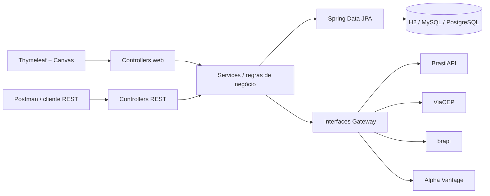
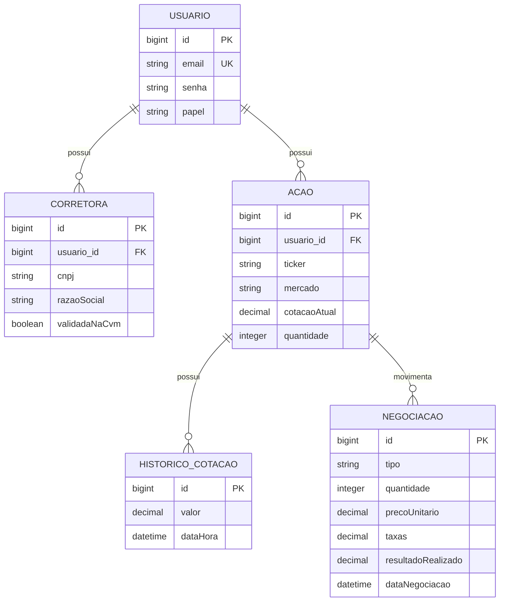

# Carteira de Ações

Aplicação acadêmica full stack em Java 17 e Spring Boot para gerenciar corretoras, ações brasileiras/americanas e negociações de compra e venda. O projeto inclui login validado, dashboard com gráficos, tabelas responsivas, API REST e especificações OpenSpec.

O visual usa como referência os padrões de navegação e densidade de informação do Status Invest e do Investidor10, sem copiar identidade visual, código ou conteúdo desses produtos.

## Funcionalidades

- Cadastro e login com Spring Security, BCrypt, validação de e-mail e política de senha.
- Carteiras totalmente isoladas por conta: uma conta nova começa sem ações, corretoras ou negociações e nunca consulta os dados de outro usuário.
- Cadastro de corretora somente após validação do CNPJ, registro na CVM e CEP.
- Cadastro de ações brasileiras e americanas somente quando o ticker existe no provedor correspondente.
- Proteção contra CNPJ, e-mail e ticker duplicados.
- Posição por ativo com saldo em unidades inteiras, preço médio, capital investido, patrimônio, resultado e rentabilidade.
- Registro de compras e vendas com preço de execução informado pelo usuário, taxa automática zero, prévia de valores, total desembolsado/recebido e resultado realizado.
- Atualização automática da posição: compras recalculam o preço médio; vendas preservam o preço médio restante e só alteram saldo e resultado realizado.
- Atualização da cotação pelo provedor com histórico persistido.
- Dashboard financeiro com doze gráficos, incluindo quatro visões simples de preço médio: valor por ação, comparação com a cotação, distância percentual e evolução por ativo. Todos os ativos brasileiros e americanos aparecem sem limite na central de preço médio.
- Logos das empresas identificadas pelo ticker na central de preço médio, nas posições, na gestão de ativos e no histórico, com inicial automática quando a imagem não estiver disponível.
- Navegação superior com dez abas e atalhos diretos para resumo, preço médio, resultados, posições, ativos, negociações, histórico, corretoras, Imposto de Renda e configurações.
- Histórico completo com busca e filtros por operação e mercado, além de volume e resultado realizado separados por moeda.
- Tela de apoio ao Imposto de Renda com consolidação anual de vendas e resultados em BRL e USD, acompanhada de avisos sobre as limitações do cálculo.
- Configurações locais de tema, movimento e densidade, persistidas no navegador.
- Temas persistentes preto piano com dourado e branco com dourado, alternância instantânea e fundo original de mármore animado com suporte a movimento reduzido.
- Identidade visual própria com símbolo geométrico de evolução financeira no lugar da antiga inicial `C`.
- Resumos separados em BRL e USD para não somar moedas diferentes de forma incorreta.
- API REST com paginação e erros centralizados no formato `ProblemDetail`.
- Documentação técnica OpenAPI restrita a administradores e removida da navegação do usuário comum.
- Configuração externa por variáveis de ambiente, sem senhas versionadas.
- Schema versionado pelo Liquibase e validado pelo Hibernate.
- Perfis de banco para H2, MySQL e PostgreSQL.
- Imagem Docker multi-stage e ambiente Compose com aplicação e PostgreSQL.
- Especificações de comportamento no diretório `openspec/`.

## Executar localmente com H2

Pré-requisitos: Java 17+ e Maven 3.9+.

```powershell
mvn spring-boot:run
```

Acesse [http://localhost:8080](http://localhost:8080). O banco H2 é criado em `./data` e o Liquibase controla sua estrutura.

Na primeira execução, crie a conta pela opção **Criar conta** na tela de login. Um usuário inicial pode ser habilitado somente por variáveis de ambiente:

```powershell
$env:DEMO_USER_ENABLED="true"
$env:DEMO_USER_EMAIL="admin@carteira.com"
$env:DEMO_USER_PASSWORD="defina-uma-senha-forte"
mvn spring-boot:run
```

Não existe senha-padrão no código. Se `DEMO_USER_ENABLED=true`, `DEMO_USER_PASSWORD` passa a ser obrigatória.

## Chaves das APIs financeiras

A brapi permite testar alguns tickers (como `PETR4`, `VALE3`, `MGLU3` e `ITUB4`) sem token. Para cobertura completa, configure:

```powershell
$env:BRAPI_TOKEN="seu-token-brapi"
$env:ALPHA_VANTAGE_API_KEY="sua-chave-alpha-vantage"
mvn spring-boot:run
```

Sem chave própria da Alpha Vantage, a chave pública `demo` normalmente permite apenas o ticker `IBM`.

## Integrações externas

| Integração | Uso | Autenticação | Limitações principais |
|---|---|---|---|
| [BrasilAPI CNPJ](https://brasilapi.com.br/docs) | Dados cadastrais da Receita Federal | Não | Serviço comunitário; sujeito a indisponibilidade e atualização da fonte |
| [BrasilAPI CVM](https://brasilapi.com.br/docs) | Confirmação de corretora registrada | Não | Reflete a base pública disponibilizada pela CVM |
| [ViaCEP](https://viacep.com.br/) | Validação e preenchimento de endereço | Não | CEP válido pode não existir; uso massivo pode ser bloqueado |
| [brapi](https://brapi.dev/docs) | Cotações e histórico de ativos brasileiros | Token para cobertura completa | Plano gratuito e tickers de teste possuem limites |
| [Alpha Vantage](https://www.alphavantage.co/documentation/) | Cotação de ações americanas | API key | Limite de requisições; cotação gratuita pode ser de fechamento |

Os clientes possuem timeout de conexão/leitura. Erros de ticker, CNPJ ou CEP inexistente, indisponibilidade e limites externos são convertidos em mensagens de domínio e, na API, retornados como HTTP `422` ou `502`.

## Endpoints da API

Os endpoints de negócio exigem autenticação (sessão da interface ou HTTP Basic):

| Método | Endpoint | Finalidade |
|---|---|---|
| `POST` | `/corretoras` | Cadastrar corretora após três validações externas |
| `GET` | `/corretoras` | Listar com paginação (`page`, `size`, `sort`) |
| `GET` | `/corretoras/{id}` | Buscar por id |
| `GET` | `/corretoras/cnpj/{cnpj}` | Buscar por CNPJ |
| `POST` | `/acoes` | Validar e cadastrar ticker |
| `GET` | `/acoes` | Listar com paginação |
| `GET` | `/acoes/{id}` | Buscar por id |
| `GET` | `/acoes/ticker/{ticker}` | Buscar por ticker |
| `PUT` | `/acoes/{id}/atualizar-cotacao` | Consultar novamente e registrar histórico |
| `PUT` | `/acoes/{id}/posicao` | Atualizar quantidade e preço médio |
| `POST` | `/negociacoes` | Registrar uma compra ou venda e recalcular a posição |
| `GET` | `/negociacoes` | Listar histórico paginado da mais recente para a mais antiga |
| `GET` | `/dashboard/dados` | Dados dos indicadores, gráficos e tabela |

Exemplo:

```powershell
curl.exe -u "$env:API_EMAIL`:$env:API_PASSWORD" `
  -H "Content-Type: application/json" `
  -d '{"ticker":"PETR4","mercado":"BRASIL"}' `
  http://localhost:8080/acoes
```

Depois registre a compra:

```powershell
curl.exe -u "$env:API_EMAIL`:$env:API_PASSWORD" `
  -H "Content-Type: application/json" `
  -d '{"acaoId":1,"tipo":"COMPRA","quantidade":100,"precoUnitario":38.50,"dataNegociacao":"2026-08-25T10:00:00"}' `
  http://localhost:8080/negociacoes
```

O preço unitário é informado pelo usuário e pode partir da cotação atual sugerida pela tela. A taxa não é enviada: o backend registra taxa zero para novas operações.

Swagger e os documentos OpenAPI continuam disponíveis para avaliação técnica, mas exigem uma conta com papel `ADMIN` e não aparecem no menu da aplicação.

A coleção pronta está em `postman/Carteira-Acao.postman_collection.json`.

## Bancos de dados

H2 é o perfil padrão. Para executar com PostgreSQL, copie `.env.example` para `.env`, substitua os valores de exemplo e forneça as variáveis ao processo pela IDE ou pelo terminal:

```powershell
$env:SPRING_PROFILES_ACTIVE="dev"
$env:DB_URL="jdbc:postgresql://localhost:5432/carteira_acao"
$env:DB_USERNAME="carteira"
$env:DB_PASSWORD="sua-senha"
mvn spring-boot:run
```

O projeto importa automaticamente o arquivo `.env` da raiz como configuração opcional. Ele já está ignorado pelo Git e pode ser usado pelo Spring Boot local e pelo Docker Compose. Valores fornecidos diretamente pelo sistema operacional continuam tendo prioridade.

Os perfis `dev` e `postgres` usam PostgreSQL. O perfil `mysql` permanece disponível. Em todos eles, `DB_PASSWORD` é obrigatória e não possui valor-padrão versionado.

## Liquibase

O Liquibase é o único responsável por criar e evoluir o schema:

```text
src/main/resources/db/changelog/
├── db.changelog-master.xml
└── changes/
    ├── 001-criar-estrutura-inicial.xml
    ├── 002-criar-negociacoes.xml
    └── 003-isolar-carteiras-por-usuario.xml
```

O Hibernate usa `ddl-auto: validate`: ele confere as entidades, mas não altera tabelas. O mesmo changelog é executado no H2 dos testes e no PostgreSQL. Para preservar o H2 local criado antes desta mudança, cada tabela já existente recebe uma linha de base; qualquer tabela ausente é criada pelo changelog e, em seguida, o Hibernate valida o conjunto completo.

Após um changeSet ser executado, não o altere. Toda evolução futura deve entrar em um novo arquivo na pasta `changes` e ser incluída ao final do master.

A migração para unidades inteiras não arredonda saldos existentes silenciosamente. Se houver alguma quantidade fracionária legada, a inicialização é interrompida com uma mensagem para que o valor seja revisado antes da conversão.

## Docker e PostgreSQL

Pré-requisito: Docker Desktop com Docker Compose.

```powershell
Copy-Item .env.example .env
```

Edite `.env`, defina uma senha local e execute:

```powershell
mvn test
docker compose config --services
docker compose up -d --build
docker compose ps
```

Com os valores sugeridos em `.env.example`, abra [http://localhost:18080](http://localhost:18080). O PostgreSQL do Compose fica disponível no computador pela porta `5433`, evitando conflito com uma instalação local na porta `5432`. A aplicação usa internamente `postgres:5432`; `localhost` deve ser usado apenas quando o Java estiver sendo executado fora dos containers.

O serviço PostgreSQL possui healthcheck e volume persistente. A aplicação só inicia depois que o banco estiver saudável, executa o Liquibase e então o Hibernate valida o schema.

Parar sem apagar os dados:

```powershell
docker compose down
```

Apagar também o banco da composição:

```powershell
docker compose down --volumes
```

O segundo comando é destrutivo e deve ser usado somente quando a intenção for recriar o banco.

## Arquitetura



Os serviços de terceiros são isolados por interfaces em `integration/gateway`. A escolha do provedor de cotação é uma Strategy baseada no mercado, permitindo substituir ou adicionar APIs sem modificar `AcaoService`.



## Testes

```powershell
mvn test
```

Os testes cobrem validação algorítmica de CNPJ, duplicidade por conta, isolamento entre usuários, saldo inteiro, integrações, proteção do dashboard, restrição administrativa do OpenAPI, cálculos de compra e venda, proteção de saldo e criação do schema pelo Liquibase.

## OpenSpec

As especificações atuais estão em `openspec/specs/`. Cada capacidade possui `spec.md` e pastas separadas para `proposta/proposal.md`, `design/design.md` e `tasks/tasks.md` com checkboxes. O índice completo está em `openspec/specs/README.md`; mudanças concluídas permanecem preservadas em `openspec/changes/archive/`.
