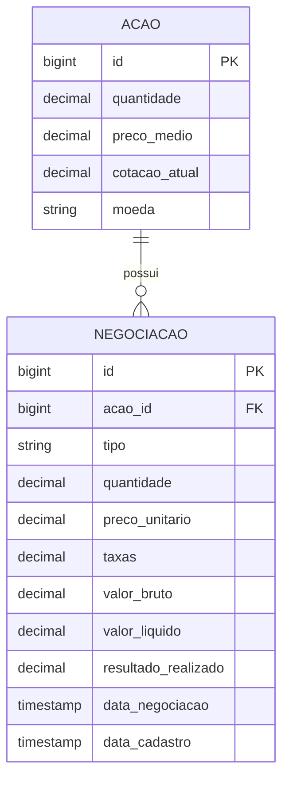
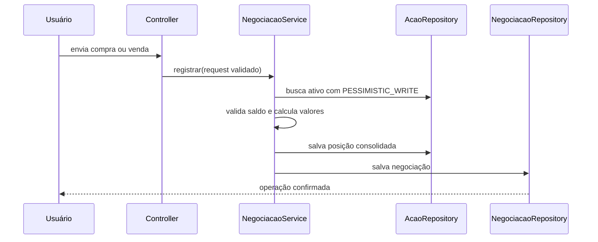

# Design: compras e vendas de ações

## Contexto

`Acao` representa ao mesmo tempo o ativo monitorado e sua posição consolidada. A nova entidade `Negociacao` registra os eventos que alteram essa posição, sem duplicar cotação ou dados cadastrais do ativo.

## Objetivos

- Manter uma trilha cronológica de compras e vendas.
- Atualizar a posição e gravar a negociação na mesma transação de banco.
- Calcular custo médio e resultado realizado de forma determinística.
- Preservar dados e changeSets existentes.
- Oferecer o fluxo completo pela interface e pela API.

## Não objetivos

- Reconstruir automaticamente posições antigas que não possuem negociações históricas.
- Implementar FIFO, LIFO ou lotes fiscais; o método adotado é custo médio ponderado.
- Consultar uma corretora externa para executar a ordem.

## Modelo de dados



Todos os valores monetários e quantidades usam `DECIMAL(19,4)`. O tipo é persistido como texto para manter o banco legível.

## Fórmulas

### Compra

```text
valorBruto = quantidadeComprada × precoUnitario
desembolso = valorBruto + taxas
novoSaldo = saldoAtual + quantidadeComprada
novoPrecoMedio = (saldoAtual × precoMedioAtual + desembolso) / novoSaldo
resultadoRealizado = 0
```

As taxas aumentam o custo da posição e, portanto, participam do novo preço médio.

### Venda

```text
valorBruto = quantidadeVendida × precoUnitario
valorRecebido = valorBruto - taxas
custoDaParcelaVendida = quantidadeVendida × precoMedioAtual
resultadoRealizado = valorRecebido - custoDaParcelaVendida
novoSaldo = saldoAtual - quantidadeVendida
```

O preço médio da parcela restante não muda. Quando o saldo chega a zero, o preço médio consolidado passa a zero.

## Fluxo transacional



`@Transactional` garante atomicidade: se qualquer gravação falhar, nem posição nem negociação ficam parcialmente registradas. O bloqueio pessimista serializa alterações concorrentes no mesmo ativo.

## Validações de domínio

- Ativo e tipo são obrigatórios.
- Quantidade e preço devem ser maiores que zero.
- Taxas devem ser maiores ou iguais a zero.
- A data não pode estar no futuro.
- A quantidade vendida não pode superar o saldo.
- Taxas de venda não podem superar o valor bruto.

Erros de validação estrutural retornam HTTP 400 na API. Violações de regra de negócio retornam HTTP 422. Na interface, a mensagem aparece junto ao formulário e nenhum dado é alterado.

## Interface

A rota `/gestao/negociacoes` contém:

- seletor do ativo mostrando saldo e moeda;
- tipo da operação;
- quantidade, preço, taxas, data e hora;
- aviso de proteção do saldo;
- histórico com bruto, taxas, total e resultado realizado.

O dashboard e a tabela de ativos direcionam o usuário para esse fluxo. A edição direta de quantidade e preço médio foi removida da tabela visual.

## Segurança da documentação técnica

O item OpenAPI é removido do fragmento de navegação. Os caminhos `/swagger-ui.html`, `/swagger-ui/**`, `/v3/api-docs/**` e `/h2-console/**` exigem papel `ADMIN`. Endpoints de negócio continuam exigindo apenas autenticação.

## Migração

O arquivo `002-criar-negociacoes.xml` é incluído após o changelog inicial. Essa ordem respeita a chave estrangeira para `acoes` e mantém o changeSet inicial imutável.

Rollback do novo changeSet remove somente `negociacoes`; não altera posições existentes. Em produção, rollback deve ser precedido de backup porque remove o histórico de operações.

## Alternativas consideradas

### Calcular a posição somando todo o histórico em cada consulta

Rejeitada para esta versão porque aumentaria o custo e exigiria migrar posições antigas sem histórico. A solução escolhida mantém o consolidado em `Acao` e o evento em `Negociacao`.

### Bloqueio otimista com campo de versão

É uma alternativa válida, mas exigiria tratamento explícito de retry e alteração adicional no schema. O bloqueio pessimista é direto para o volume acadêmico previsto.

### Excluir completamente o Springdoc

Rejeitada porque o contrato continua útil para administração e avaliação técnica. A interface foi ocultada do usuário comum e protegida por papel.

## Estratégia de testes

- Teste unitário da compra e do preço médio com taxas.
- Teste unitário da venda e do resultado realizado.
- Teste de rejeição de venda acima do saldo sem persistência parcial.
- Teste de segurança garantindo HTTP 403 para `USER` e acesso para `ADMIN`.
- Teste de migration confirmando cinco tabelas e cinco changeSets.
- Teste HTTP da tela, da API e de uma compra/venda real sobre H2 persistente.
